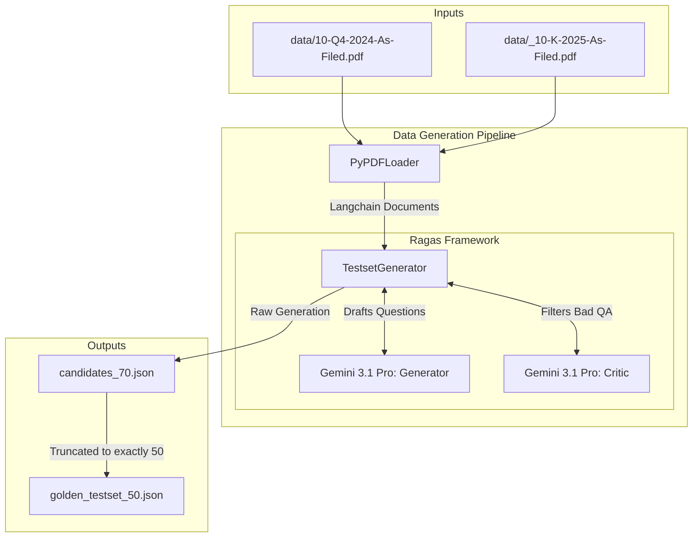
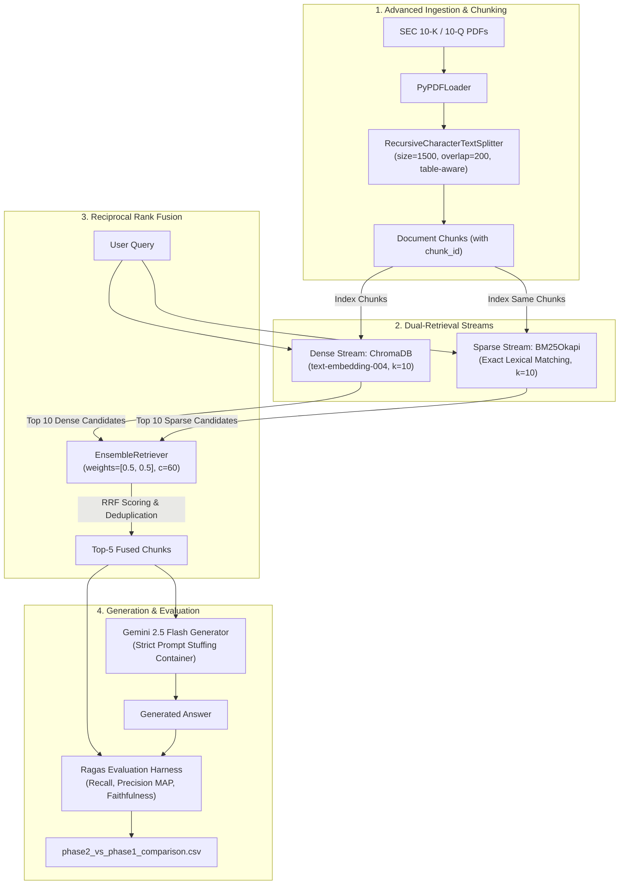

# SEC RAG: System Explanations & Architecture

This document tracks the reasoning, implementation details, and architecture diagrams for every component we add to the SEC RAG project. It is intended to keep us perfectly aligned on *why* and *how* each part of the system is built.

---

## 1. Synthetic Testset Generation (Ragas)
**Component**: `generate_testset.py`
**Added**: September 2026

### Why we added it
To evaluate the SEC RAG system effectively without drowning in API costs or relying on unreliably small sample sizes, we needed a frozen "golden" dataset of 50 validated triplets (Question, Context, Answer). Generating this synthetically ensures we have a stable, reproducible baseline to measure retrieval and generation performance against as we tweak the RAG architecture. 

By oversampling (requesting 70 candidates) using a high-tier reasoning model (Gemini 3.1 Pro (Preview)), we guarantee at least 50 high-quality questions. We intentionally structured the dataset to test specific failure modes:
- **Simple / Factoid (20%)**: Baseline lookups (e.g., corporate officers).
- **Conditioning (25%)**: Precision on exceptions and risk qualifiers.
- **Reasoning / Arithmetic (30%)**: Generator calculation capability.
- **Multi-Context (25%)**: Cross-section retrieval (e.g., comparing MD&A to Notes).

### How it works
1. **Document Ingestion**: We ingest the multi-year SEC filings (10-K/10-Q) from the `data/` directory using Langchain's `PyPDFLoader`.
2. **Generator Setup**: We configure `ragas.testset.generator.TestsetGenerator` and hook it up to Gemini 3.1 Pro (Preview). Gemini acts as both the **Generator** (crafting the questions) and the **Critic** (filtering out poorly worded questions, like those leaking references to "the provided passage").
3. **Evolutionary Generation**: Ragas applies evolutionary mutations (simple, reasoning, multi-context, conditional) matching our exact percentage distribution.
4. **Serialization**: The generated candidates are exported to a pandas DataFrame. We save the raw batch to `candidates_70.json` for backup, and slice the top 50 valid questions into `golden_testset_50.json` to freeze the dataset.

### External Dependencies & How They Work
- **LangChain (`langchain`, `langchain-community`, `langchain-google-genai`)**: A framework for orchestrating LLM workflows. We use it here primarily as the standard interface (wrapper) to communicate with Gemini (`ChatGoogleGenerativeAI`, `GoogleGenerativeAIEmbeddings`) and to standardize our PDF text extracts into LangChain `Document` objects that Ragas can seamlessly consume.
- **Ragas (`ragas<0.2.0`)**: A framework for Evaluating RAG systems. We use its `TestsetGenerator` module which works by extracting key phrases/nodes from the documents and then applying "evolutions" (prompting templates) to force the LLM to generate questions of varying complexity. We pinned it to `<0.2.0` to preserve the specific evolutionary distribution API (Simple, Reasoning, Conditioning, Multi-Context) which was overhauled in later versions.
- **PyPDF (`pypdf`)**: A pure-Python library utilized via Langchain's `PyPDFLoader`. It works by parsing the binary structure of the PDF file, extracting text streams page by page, and preserving basic paragraph structures, which allows Ragas to process the text sequentially.
- **Google Generative AI APIs**: We use Gemini 3.1 Pro (Preview) to power both the question generation (requiring deep contextual understanding of long SEC contexts) and the critic evaluation (requiring strict adherence to rubrics, e.g., filtering out questions that say "according to the text").

### System Diagram

---

## 2. Phase 2: Hybrid Search Architecture (Dense-Sparse Reciprocal Rank Fusion)
**Component**: `run_v2_hybrid.py`  
**Added**: October 2026

### Why we added it
In Phase 1, our Naive RAG baseline (fixed 1000-character chunking + single-stage dense cosine retrieval) suffered from critical failure modes on SEC 10-K filings:
1. **Financial Table Fragmentation**: Complex tabular disclosures (e.g., Segment Net Sales, Debt and Note maturity schedules, Operating Income) span 1,200 to 1,500 characters. Fixed 1000-character windows amputated column headers from row metrics.
2. **Dense Embedding Semantic Drift**: Dense embedding models map queries to broad semantic concepts. For queries requiring exact numerical anchors (e.g., `"0.875% Notes due 2025"`, `"September 28, 2024"`, `"CODM"`), dense search often retrieves conceptually related text rather than the exact row.
3. **"Lost in the Middle"**: When candidate chunks are stuffed into the prompt, the LLM pays disproportionate attention to the top and bottom of the context window. Critical financial chunks ranked 4th or 5th (or pushed out of top-5) failed to generate answers.

### Architecture Specifications
1. **Advanced Chunking**:
   - Upgraded to `chunk_size=1500`, `chunk_overlap=200` with semantic boundary and table-aware separators (`\n\n\n`, `\n\n`, `\n(?=[A-Z0-9\$\(])`, `\n`, ` `).
   - Preserves complete table blocks and attaches unique `chunk_id` metadata.
2. **Dual-Retrieval Streams**:
   - **Stream A (Dense Retriever)**: ChromaDB vector store with `text-embedding-004` (cosine similarity), retrieving top $k=10$ candidate chunks.
   - **Stream B (Sparse Retriever)**: LangChain `BM25Retriever` initialized over the exact same chunk pool, retrieving top $k=10$ candidate chunks based on exact keyword term frequencies.
3. **Reciprocal Rank Fusion (RRF)**:
   - Fused via `EnsembleRetriever` with weights $[0.5, 0.5]$ and smoothing constant $c=60$:
     $$RRF\_Score(d) = \sum_{r \in \{dense, sparse\}} \frac{w_r}{60 + rank_r(d)}$$
   - Documents matching both dense semantic intent and exact sparse keywords receive a substantial score boost, ranking at ranks 1–2.
   - Truncated to the top $k=5$ fused documents for generation.
4. **Generation & Evaluation**:
   - Generation via Gemini 2.5 Flash (`temperature=0.0`) using the Phase 1 strict negative constraint prompt container.
   - Automated evaluation via Ragas metrics (Context Recall, Context Precision MAP, Faithfulness) with side-by-side Pandas comparison against Phase 1.

### System Diagram

